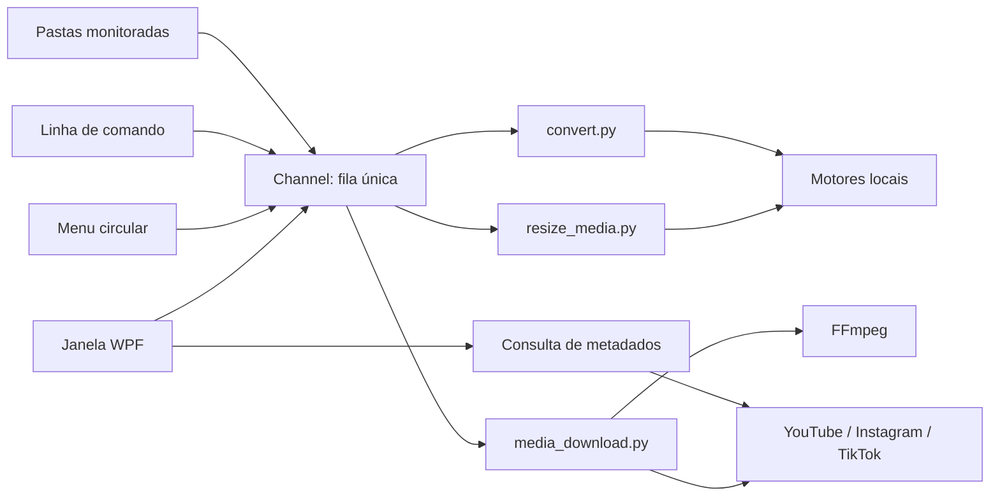

# Arquitetura

O Conversor é um aplicativo WPF para Windows x64. A interface agenda tarefas e acompanha eventos; conversão e download rodam em processos Python separados. Encerrar ou cancelar um worker não encerra a interface.

## Responsabilidades

| Área | Responsabilidade |
|---|---|
| `MainWindow.xaml` e seu code-behind | Navegação e ações da janela |
| `Features/Media` | Downloads, redimensionamento e serviço de prévia |
| `Infrastructure/DesktopSession.cs` | Bandeja, janela, início com Windows e ciclo de vida dos serviços |
| `Program.cs` | Entrada do aplicativo e controle de instância única |
| `ConversionQueue.cs` | Fila serial, vida dos workers, cancelamento e histórico |
| `Conversion/ConversionJob.cs` | Estado persistível de cada tarefa |
| `Configuration` | Preferências e regras de monitoramento |
| `Infrastructure` | Caminhos, persistência e configuração dos processos |
| `Catalog.cs` | Pares de conversão disponíveis conforme componentes instalados |
| `GestureService.cs` / `RadialWindow.cs` | Detecção do gesto global e recebimento do arquivo via OLE |
| `worker` | Operações sobre arquivos e integração com os motores |

## Decisões e limites

Uma fila única evita concorrência acidental de motores pesados. A análise de links pode rodar fora dela porque o usuário precisa consultar a qualidade antes de agendar o download; essa consulta tem cancelamento e tempo limite.

O processo continua ativo quando a janela recebe o fechamento pelo X. `DesktopSession` esconde a janela nesse caso; o comando Sair da bandeja realiza o encerramento explícito. O atalho reativa a instância existente. Início automático é uma preferência gravada para o usuário atual do Windows.

`ResizePreviewService` executa o worker e carrega os pixels antes de remover o arquivo temporário. A janela fica responsável pela seleção, validação e exibição da prévia. As medidas e os rótulos dos presets ficam juntos para evitar listas paralelas que possam sair de sincronia.

O protocolo dos workers é JSON por stdin/stdout, com eventos de progresso, saídas, avisos e erro. stderr fica reservado para diagnóstico. O transporte usa UTF-8 explicitamente para preservar caminhos acentuados. `ProcessScope` associa cada worker a um Windows Job Object para controlar processos descendentes.

Resultados são preparados em uma área temporária. Ao publicar, um nome é reservado de forma exclusiva; conflitos recebem um número. Bloqueios temporários de gravação recebem tentativas limitadas. Um cancelamento não remove itens de playlist já publicados.

Downloads usam yt-dlp por sua API Python, com FFmpeg para juntar fluxos/remuxar ou extrair áudio. Deno e yt-dlp-ejs são preparados antecipadamente para o suporte ao YouTube. curl-cffi é necessário para o acesso HTTP usado por alguns extratores, incluindo o TikTok. A aplicação não importa contas/cookies do navegador.

Resolução é um limite máximo, não uma promessa de resolução disponível. Em playlists, as opções vêm do primeiro item acessível; o limite é reaplicado aos demais. O contêiner escolhido não transforma automaticamente todos os codecs em um único codec. WAV/FLAC não recuperam detalhes perdidos na origem.

A fila fica em memória; o histórico permite consultar resultados, mas não é um mecanismo de retomada de downloads após fechar o aplicativo. Arquivos temporários de tarefas interrompidas podem exigir limpeza posterior. Atualizações dos motores são manuais.
